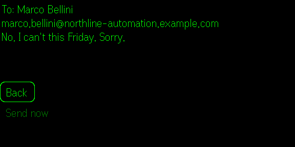
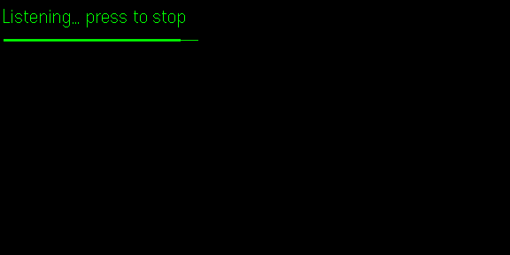
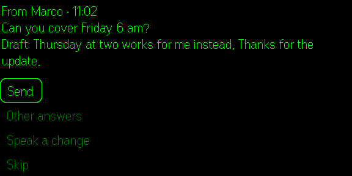
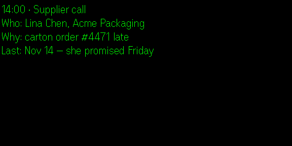
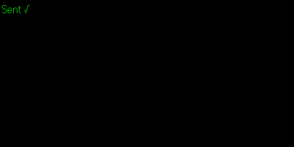
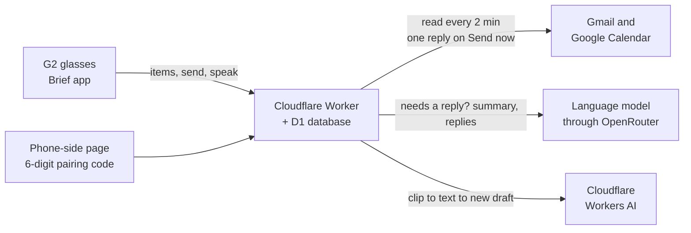

# Brief

**The few messages that need you, on your Even Realities G2 glasses, each with a reply ready.
One look, two presses, sent. Nothing ever leaves on its own.**

**The film (2 min, the app in the Even Realities simulator):** https://brief-film.pages.dev/brief.mp4

<p>
  
  
</p>

**See who is waiting.** `2 need you`, the time and the next meeting on one line. A press opens a mail: a few words
of summary and the reply Brief drafted for you.

<p>
  
  
</p>

**Pick another answer, then send with two presses.** `Other answers` offers four more. `Send` shows the name and the
full address; only `Send now` lets the reply go.

<p>
  
  
</p>

**Or say it.** `Speak a change` listens until you press, then rewrites the reply from what you said. Speaking never
sends: the new draft waits for the same two presses.

<p>
  
  
</p>

**Before a meeting, and after a send.** From ten minutes before an event: who, why, the last thing said. `Sent √`
appears only once the server has confirmed it.

These are the simulator's own screenshots (576×288, what the glasses draw). `npm run shots` makes all 44 of them again.

## The problem

A phone shows everything. Glasses cannot: the display has room for a few lines, and your hands are busy. So the
sorting has to happen before anything is drawn.

Brief reads one Gmail label and your calendar, keeps the mails that need an answer from you, and prepares that
answer. You see `2 need you`, you clear both with a few presses, and the phone stays in your pocket.

It is made for people who work standing up: a shift supervisor on a factory floor, a technician on a site visit,
anyone walking between two meetings. The demo follows one of them: Marco asks for a Friday 6 am cover, Priya reports
a line that tripped twice, and a supplier call starts at 14:00. All of them are invented.

## What it does

- **Reads: Gmail and Google Calendar.** Every two minutes the server reads one Gmail label and the primary calendar
  of the signed-in account, with read-only scopes. Each new mail is triaged once by a language model: does it need a
  reply from you, a summary of six words at most, a draft, four other answers. Every answer is checked before it is stored
  (length, allowed characters, no link) and checked again before it is served.
- **Writes: Gmail.** `Send`, then `Send now`: one reply leaves through the Gmail API (scope `gmail.send`), in the
  original thread, signed `Sent from my glasses with Brief`. Two presses at the same moment still give one mail.
- **Listens: the G2 microphone.** `Speak a change` records up to 10 seconds. The server turns the clip into text and
  has the reply rewritten from it. The clip and its text are not kept; only the new draft is, and it goes through
  the same two presses.
- **Briefs you before a meeting.** From ten minutes before a calendar event until it starts: who, why, and the last
  thing said. In this build a brief is written only for a timed event that you created or organize and that invites
  one of the sandbox contacts.
- **Fails in plain words.** `No connection — retrying` retries by itself. `Not sent. Send now to try again.` when a
  send failed. `Not confirmed. Check Sent on your phone.` when Gmail did not answer in time: a send is never retried
  on its own. `Sign-in needed` comes with its steps. Never an error code on the glasses.

## Try it

The deployed app opens in demo mode: invented people, no sign-in, nothing is sent (`Sent √` comes with the line
`Demo: no real mail was sent`).

```sh
# the vendor's simulator (@evenrealities/evenhub-simulator on npm; we use 0.9.5)
evenhub-simulator https://brief.appfinishers.com/app/

# or from this repository, in a container (see « Run it »)
tools/sim.sh start https://brief.appfinishers.com/app/
```

Scroll to move the highlight, press to choose. A double press asks for the system's exit dialog (and turns the
microphone off first if the glasses were listening). `Speak a change` needs an audio input: we drive it with a virtual
microphone (`SIM_MIC=1`, see « Known limits »); a desktop microphone is not checked.

On G2 glasses the vendor's CLI prints a development QR code for the Even app:
`evenhub qr --url https://brief.appfinishers.com/app/`. We have not checked that path: see « Not checked yet ».

Paired mode (a real Gmail label and a real calendar) is behind an allow-list. The public server pairs only with our
own sandbox account: the Google project is in test mode, and we wanted no real person's mail in a contest build. To
pair your own account, run your own Worker (`server/worker/README.md`).

## How it is built



- **Glasses app** (`src/`): TypeScript and Vite on the vendor's SDK. The logic (the list, the two-press rule, the
  reply checks, the press guard) is pure and tested without the SDK. `npm run shots` walks 44 screens in the
  simulator and checks the size and the line widths of each PNG.
- **Server** (`server/worker/`): one Cloudflare Worker on the Free plan, one D1 database, a cron every two minutes.
  Sign-in happens on a separate page and gives a 6-digit pairing code, because Google sign-in does not work inside
  the glasses app's WebView.
- **Triage** (`server/triage/`): the questions go to OpenRouter, to a chain of three free models tried in order. A
  Claude provider is written and tested against a local fake; it has not run live yet.
- **Voice**: `@cf/openai/whisper-large-v3-turbo` for the text, `@cf/meta/llama-3.3-70b-instruct-fp8-fast` for the
  rewrite, both through the Workers AI binding (no key).
- **Checks**: 128 tests for the app, 130 for the triage layer and its scripts, 238 for the Worker, 15 for the seed
  tools. Before a deploy the same lists run again, then one live call on the deployed build.

## Safety by design

- **Two presses, and only what you saw.** `Send now` posts the number of the reply on screen (for a spoken draft,
  its revision), never a text. The server sends the stored reply with that number, or refuses.
- **The server picks the recipient.** It is computed from Gmail's own copy of the mail, never from the request. No
  Cc, no Bcc, no Reply-To.
- **A sandbox for the contest.** Each contact is one of the signed-in account's own plus-aliases under an invented
  name: the glasses show the invented address, and a real send reaches only that alias, behind a switch (`REAL_SEND`,
  off by default) and a daily cap. The sync skips any mail that travelled over SMTP, or sits in Spam or Trash: it reads
  only what the owner placed in the label. So no real person's mail reaches a model in this build.
- **Little is stored.** Gmail ids, the checked summary and replies, calendar event titles and the checked brief
  lines, a spoken draft, times and states. Never a mail body, a mail subject, an address or a token in clear: tokens and codes are kept as SHA-256, the Google refresh token under AES-256-GCM,
  addresses as hashes (a pseudonym, not anonymity: `server/worker/README.md`, « Known limits »).
- **Strangers are turned away.** An account that is not on the allow-list gets a refusal page, none of its
  tokens is stored, and the server asks Google at once to revoke its grant.
- **The microphone is off by default.** It opens only after you pick `Speak a change` and closes on every way out.
  The clip and what was heard are not stored and not logged.
- **Quiet logs, hard limits.** A log line carries a route, a status, a code or a count; never a token, an address, a
  mail or a spoken word. Sends (20 a day per account), model requests (30 a day), clips (40 a day per network
  address) and Workers AI units (3,000 a day) all have a daily cap.

## What existed before Nov 23

The contest's build week started on 2026-11-23 at 03:00 EST (12:00 in Dubai). No app code existed before that. The
first two commits here are from 03:16 that day, about 3,500 lines: two builder agents wrote them in parallel, from
03:00, out of the design notes listed below.

Brought into this repository on 2026-11-23 so a clone runs on its own; their content was unchanged that day except the
paths, and each later change is listed with its item:

- `tools/sim.sh`, `tools/sim-container/Containerfile`, `tools/package.json`, `tools/package-lock.json`: the simulator
  launcher (dev tooling written 2026-11-18). It runs the official Even Hub simulator in a podman container on our
  machine. Day 2 changes: the simulator binary is found next to the script (`tools/node_modules`, was a path in our home
  folder) and the two package versions are pinned exact (`@evenrealities/evenhub-cli` 0.2.0,
  `@evenrealities/evenhub-simulator` 0.9.5, were `^` ranges). Changed again during the build week: the address and the
  port passed as arguments and a storage volume (day 4), a virtual microphone (day 5: `SIM_MIC=1`, `sim.sh speak`,
  `tools/sim-container/Containerfile.mic`, `tools/mic-probe/`).
- `demo/dataset.json` and `demo/README.md`: the fictional demo dataset (written 2026-11-19; every person, company and
  address in it is invented). `src/data/dataset.json` is a byte-identical copy (a test checks it).
- The design notes (screens, gestures and plan, written as text before the build week; kept outside this repository).

Also done before the build week, with no app code: reading the SDK's documentation, choosing the models (throwaway
test scripts, not kept here), opening the accounts and the Google Cloud project.

Everything else is written from 2026-11-23 03:00 EST. `@evenrealities/even_hub_sdk` is the vendor's SDK; its published
`dist` is obfuscated by the vendor.

## Built with AI agents

Said plainly: the code, the tests and the docs in this repository were written by AI agents (Claude models). One
orchestrating agent writes each day's work order. Builder agents write the code, a reviewer agent attacks it, a
tester agent walks it in the simulator. Then the orchestrator runs every check again itself and makes one live call
on the deployed build before the day counts as done. A human owns the accounts and did the Google sign-in on a phone.

The words « job A », « review note », « the gate » and « the CEO » in the notes and the commit messages come from
that process (the CEO is the orchestrating agent). The work orders (`BRIEF-D*.md`) and the reports they point to are
not in this repository.

## Not checked yet

- **Real G2 glasses.** We have none. Every screen, press and clip here ran in the vendor's simulator 0.9.5, the
  microphone through a virtual audio device. Not checked: the real microphone (its delay, its chunk size, a real
  voice), the exit dialog on a double press (the simulator draws nothing), what the glasses' font draws for `√`, and
  the QR path of « Try it ».
- **Meaning.** A spoken rewrite is checked for its form, not for what it says: a wrong hour in a well-formed
  sentence becomes the draft. Your eyes and the two presses are the guard.
- **Languages.** English only.
- **One label, one account.** Paired mode reads one Gmail label of an allow-listed account, and the Google project
  is in test mode (a grant lives 7 days).
- **Telegram.** The item format and the screens carry Telegram items (the demo data has one; screens `08`, `09`,
  `17`, `18`), and the app shows mail only by default. Nothing reads or writes a real Telegram chat.

Made for the Even Realities « Heads Up » hackathon on DoraHacks (23 to 29 November 2026), track AI Assistants & Work.

## Run it

Node 24 or newer.

```sh
npm ci --ignore-scripts
npm run dev     # 127.0.0.1:5173
npm test        # pure logic: list building, the two-press send rule, reply checks, the backend client, PNG flattening
npm run build   # type check + Vite build into dist/ (relative asset paths: works under /app/ and in an Even Hub package)
npm run shots   # walks every screen in the simulator, writes docs/screens/*.png (RGB on black), checks size and line widths;
                # the backend runs use a second dev server (127.0.0.1:5174) and the in-memory stub of test/stub-backend.ts (127.0.0.1:8788)
(cd server && npm test && npm run test:py)                 # the triage layer, its scripts, the seed tools (Python 3)
(cd server/worker && npm ci --ignore-scripts && npm test)  # the Worker, on wrangler.local.toml (no login needed)
```

The whole thing on one machine, with local fakes in place of Google and the models: `server/worker/README.md`,
« Local run ».

`npm run shots` needs podman, the image built once (`podman build -t localhost/er-sim:bookworm tools/sim-container`)
and the simulator packages (`cd tools && npm ci --ignore-scripts`). Without those packages three of the app's 128
tests are skipped (« no simulator binary installed »); everything else runs with Node alone.

## Reference notes

The exact behaviour, screen by screen, for whoever changes the code.

### Data source

- `static` (default): the demo dataset in `src/data/`. Tests and `npm run shots` always run on it.
- `backend`: build with `VITE_DATA_SOURCE=backend`. The app asks the Brief Worker on the same origin
  (`https://brief.appfinishers.com/app/` → `/api/…`); `VITE_API_BASE=http://127.0.0.1:8787` points it at a local Worker.
  On start it opens a demo session (a stored paired session wins), loads the items, and shows the same screens.
  `Send now` posts only the index of the reply shown (0 = the draft, 1–4 = an alternative) and shows `Sent` only after the
  Worker answers 200. Whether a real mail leaves is the Worker's decision (day 4: paired, `REAL_SEND` on); its answer
  `"real":false` adds the line `Demo: no real mail was sent` (`Demo: no real message was sent` for a Telegram item). `send_failed` keeps C with
  `Not sent. Send now to try again.` (the cursor is back on `Back`, so the line names the row)
  (`Send now` posts the same index again) · `send_unknown` → `Not confirmed. Check Sent on your phone.` (a press opens the
  next item) · `daily_cap` → `Daily send limit reached. Try tomorrow.` · `already_handled` → `Already handled.`, then the
  list is read again. A failure shows a plain line on the glasses, never an error code.
- Calendar (day 3): after the list, the app asks `GET /api/calendar`; its `now` is the clock in the header and its events
  give `next 14:00 Supplier call` and the meeting brief (E, due from 10 minutes before an event that has a brief until
  it starts). A failed calendar call never blocks the list: the header then shows the device's own clock (local `HH:MM`) and no `next`.
- `No connection — retrying` retries by itself after 2 s, 5 s, 15 s, then every 30 s; a press retries at once; the timer
  stops once the list loads and while the app is in the background (SDK events 5 / 6 / 7; it resumes on 4).
- A paired account whose Google grant is dead (403 `signin_needed`) shows « Sign-in needed » and two numbered steps with
  `<host>/connect` (the host from `src/config.ts`); the phone-side page shows the same steps, the address as plain text and
  a copy button. The paired session is kept. A paired session the server no longer knows (401) is forgotten, never silently swapped for
  demo data: the glasses show « Sign-in needed », the phone-side page says the session ended, and a press shows demo data.
- The phone-side page shows which data the glasses show (« Demo data » or « Your inbox »), the code form, and
  « Disconnect » while paired: `POST /api/session/logout` first (3 s at most, any failure ignored), then the session is
  forgotten in the SDK storage whatever the answer; the page says the session is closed; back to demo.
- Pairing: the phone-side page shows « Have a code? »; the 6-digit code from `brief.appfinishers.com/connect` gives a
  paired session, kept with the SDK's storage. `VITE_REQUIRE_PAIRING=1` makes the glasses show « Sign-in needed » until
  then (default off = demo mode).
- Dev pairing, for the simulator (it cannot type in the phone-side page): on the dev server only (`import.meta.env.DEV`),
  `?pair=<6 digits>` in the app's address is claimed through `/api/pair/claim` at start, stored like a typed code, then
  removed from the address (`src/dev-pair.ts`; `npm test` builds both production builds and finds it in no file of
  `dist/`). With the simulator: `tools/sim.sh start 'http://127.0.0.1:5174/?pair=123456'`. `sim.sh` keeps the simulator
  user's home on the podman volume `er-sim-data` (`SIM_VOLUME=` for none, `sim.sh wipe` removes it); see Known limits.
- « Speak a change » (day 5, backend mode, demo and paired; offered only when the items answer says `"voice": true`, so
  never in static mode): B's fourth row. After the pick the glasses draw `Listening… press to stop` with an 11-cell level
  bar, THEN turn on the glasses microphone (`audioControl(true, AudioInputSource.Glasses)`); it stops on a press, at 10 s of
  sound (320,000 bytes) or 12 s on the clock, and is turned off before anything else, on every way out (the stop, each
  error, the double-press, the background, an abnormal exit). What leaves the glasses: that clip only, raw samples (16 kHz,
  16-bit, mono, 10 s at most), posted once to the Brief server (`POST /api/items/<id>/speak?base=<n>`); the server turns
  it into text with Cloudflare Workers AI, has the reply rewritten from four things (the sender's first name, the six-word
  summary, the reply on screen, what you said), checks it and keeps only that new draft. The clip and its text are not
  kept, on the glasses or on the server. The app shows `Draft: <the new reply>`; `Send` → C → `Send now` posts
  `{"choice":5,"rev":"<8 hex>"}`, so only the draft you saw can leave. Speaking never sends.
- Dev-only clip (`src/dev-voice.ts`, dev server only, found in no file of `dist/`): `?clip=<a same-origin path>` (raw
  samples or a WAV) replaces the microphone, 3,200 bytes every 100 ms then silence; the walk makes its own tone at run time.
- `SOURCES` (`src/config.ts`) is mail only by default; with Telegram on, Telegram items join the same list with a « TG » tag.
  The `?sources=`, `?at=` and `?states=1` URL switches work on the dev server only.

### Screens (`docs/screens/`)

`22` to `27` are backend mode against the stub: E opened by the calendar answer (`22`), A with the answer's clock and
`next` (`23`), A when the calendar call fails (`24`), « Sign-in needed » from a 403 (`25`), « No connection » (`26`) and
the list back after the automatic retry, with no press (`27`).

Day 4: `28` to `30` are the three new F lines (static preview: `Daily send limit…`, `Already handled.`, `Not confirmed…`);
`31` to `34` are backend mode, paired through `?pair=` with the stub's `REAL_SEND` on: C after `send_failed` (`31`), `Sent`
after a real send, no demo line (`32`), `Not confirmed` after `send_unknown` (`33`), and the demo session's `Sent` with
`Demo: no real mail was sent` (`34`). Changed on day 4: `06` and `18` (the demo line), `13` and `25` (« Sign-in needed »
in three lines; `25` shows the stub's host `127.0.0.1:8788`), `24` (the device clock in the header; the walk fixes
it with the dev-only `?at=13:53`, so the PNG is the same at every run). Every other PNG is byte-identical.

Day 5 (« Speak a change », backend mode against the stub, paired through `?pair=`, the dev-only `?clip=` tone instead of
the microphone): B with four rows (`35`), D listening with the bar part full (`36`), `Rewriting…` (`37`), B with the
spoken draft (`38`), C with it (`39`), then the five lines: `Didn't hear you.` (`40`), `Couldn't change the reply.` (`41`),
`Voice limit reached.` (`42`), `That draft is gone.` (`43`, a `Send now` whose stored spoken draft is gone) and
`No microphone.` (`44`: the simulator's own microphone, no audio device in its jail). B with three rows is unchanged
(static mode never offers the voice): all 34 earlier PNGs are byte-identical.

`19-double-press-sim.png`: on a double-press the app calls the system exit dialog (`shutDownPageContainer(1)`). The
simulator (0.9.5) draws no dialog: the glasses canvas goes black. What the real glasses show is not checked yet.

### Known limits

- « Speak a change »: what the user said is read only by their own eyes on B and C: the server's check
  (`checkSpoken`) refuses a link, a long text or an unsafe one, but cannot know a wrong hour or a promise the user did not
  make; `Send` → `Send now` stays the only way out. English only, no live text while speaking. The microphone path was
  walked two ways: the screenshot walk uses the dev-only clip, and at the day-5 gate the deployed app ran in the
  simulator with a virtual microphone (below): a synthetic voice clip played into it was heard, the reply rewritten,
  shown as `Draft:` and sent as a demo send. There the first sound came 0.6 to 2.0 s after the start, so the « no
  microphone » watch is 5 s. The real glasses' microphone, its delay and its chunk size are not checked here.
  Voice in the simulator: build once `podman build -t localhost/er-sim:mic -f tools/sim-container/Containerfile.mic
  tools/sim-container`, then `SIM_MIC=1 tools/sim.sh start <url>`. The app gets 100 ms audio events (silence between
  clips; silence reads as a constant 128, not 0). `tools/sim.sh speak clip.wav` plays a 16 kHz mono WAV into it at real
  speed (start the clip with about 2.5 s of silence: sound played before the microphone has started is lost).
  `tools/mic-probe/serve.sh` serves a console probe. Limits (the server's): 12 clips per session per hour, 30 per address per hour and 40 per
  address per day, a daily budget of Workers AI units for all users (`VOICE_DAILY_NEURONS`).

- The exit dialog (double press) draws nothing in the simulator 0.9.5 (`19-double-press-sim.png` is black); real glasses not checked.
- The simulator 0.9.5 keeps the SDK storage (`setLocalStorage`) in memory only: after a dev pairing, nothing on disk holds
  it (seen 2026-11-23: no file of the simulator's home holds the key, even after a graceful `podman stop`), so a
  `sim.sh stop` + `start` comes back unpaired even with the volume; pass `?pair=` with a fresh code again. Real glasses
  keep it in the Even app (not checked here).
